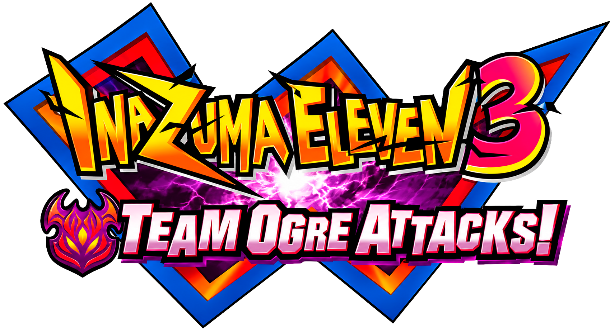

<p align="center">
  
</p>

<h1 align="center">Inazuma Eleven 3: The Ogre — Recomp</h1>

<p align="center">
  <b>English</b> · <a href="README.pt-BR.md">Português</a>
</p>

<p align="center">
  <a href="../../releases/latest"></a>
  
  <a href="LICENSE"></a>
</p>

<p align="center">
  A native PC port of <b>Inazuma Eleven 3: Sekai heno Chousen!! The Ogre</b> (Nintendo DS)<br>
  through <b>static recompilation</b> from ARM to C++. No emulator: the game's code becomes a PC program.
</p>

<p align="center">
  <a href="#what-the-port-adds">What it adds</a> ·
  <a href="#how-to-play">How to play</a> ·
  <a href="#controls">Controls</a> ·
  <a href="#mods-and-the-pt-br-translation">Mods</a> ·
  <a href="#building">Building</a> ·
  <a href="docs/DESENVOLVIMENTO.md">Development</a> ·
  <a href="#reporting-problems">Problems</a>
</p>

> [!WARNING]
> **Pre-alpha.** The game runs with 2D/3D graphics, sound, videos and controls, and the story has been played past
> the first match, but there are still bugs. Back up your saves and report problems on the [issues](../../issues)
> page.

> [!IMPORTANT]
> **The game is not included.** Releases carry no game data or code: the launcher prepares everything on your PC
> from a dump of **your own** cartridge. This is a non-profit fan project with no affiliation to LEVEL-5 or
> Nintendo.

> [!NOTE]
> AI tools assist the development of this project. Its direction, technical decisions and testing are the
> maintainer's, who reviews every change before publishing it.

> [!NOTE]
> The game itself is the Japanese version. The launcher and the in-game pause menu are in English by default, with
> Brazilian Portuguese as an option ("Language / Idioma" on the launcher's home screen). The documentation in `docs/` is in
> Brazilian Portuguese; this README is the English overview.

## What the port adds

Everything the cartridge does, plus:

| | On the DS | In this port |
|---|---|---|
| 🎨 **Graphics** | 3D at 256×192 | 3D at **1× to 10×** with anti-aliasing; **16:9** layout (the bottom screen large, the two small ones beside it) or stacked screens |
| 💾 **Progress** | the game's save | **5 savestates** and up to 30 s of **rewind** |
| 🏆 **Achievements** | — | **34 local achievements** per save (chapters, team level, roster, the captain of each team you face), with a popup in game, a page in the pause menu and in the launcher. Nothing online: each save has a `.achievements.json` next to it |
| ⏩ **Speed** | normal | **fast-forward** from 2× to 10× and auto-A |
| 🎮 **Controls** | buttons and stylus | keyboard, mouse on the touch screen and **controllers**, all remappable |
| ⚙️ **Interface** | — | a **pause menu** (settings, savestates, achievements) and a **launcher** that prepares, updates and manages saves and mods, in English or Portuguese |
| 🧩 **Content** | the cartridge | **mods** as folders or `.zip` files, including the PT-BR translation |
| 🐞 **Bug reports** | — | a log, an exact replay and a history of every session (F8 marks the moment) |

Nintendo WFC (Wi-Fi) is shut down and stays disabled.

## How to play

**Requirements:** Windows 10 or 11 (x64), a dump of your cartridge (see below) and an internet connection the
first time, to download the compiler.

1. Download `ie3ogre-recomp-<version>-windows.zip` from the [latest release](../../releases/latest) and extract it
   to a folder you can write to (Documents, for example; avoid "Program Files").
2. Open `ie3-launcher.exe` and pick your dump, or drag the `.nds` onto the window.
3. The launcher checks the dump, creates `boej.pak` (the game's data, ~450 MB), downloads the
   [llvm-mingw](https://github.com/mstorsjo/llvm-mingw) compiler once (~190 MB) and compiles `boej.exe`. This takes
   one to a few minutes, depending on your CPU. Then just click **Play**: the dump is no longer needed.

The other pages of the launcher's menu:

| Page | What it does |
|---|---|
| **Settings** | video, audio, controls and the launcher's language (also in the in-game pause menu, with Esc) |
| **Saves** | picks the save the game uses, creates new saves and imports `.sav` files from a cartridge or emulators |
| **Mods** | adds, enables, orders and removes mods; creates a mod from a modified dump |
| **Achievements** | each save's achievements, with when they were unlocked; also checks an older or imported save |
| **Updates** | downloads the new version and recompiles the game without asking for the dump; saves, settings and mods are kept |

Everything stays in the launcher's folder: `saves/` (with each save's achievements), `savestates/`, `mods/`,
`logs/` and `boej.ini` (settings). The [`README.txt`](launcher/README.txt) that ships with the release explains each one.

### Supported dump

| Game | Code | SHA-1 of the `.nds` |
|---|---|---|
| Inazuma Eleven 3: Sekai heno Chousen!! The Ogre (Japan) | `BOEJ` | `9380f1d7ee75e7c6ef24f1b76c88ecdc85088957` |

Only the unmodified retail dump (for a translation shipped as an `.nds`, see
[Mods](#mods-and-the-pt-br-translation)). The other IE3 versions (Bomber, Spark and the European 3DS release) are
not supported. If your dump has a different SHA-1, open an issue with the hash.

## Controls

| DS | Keyboard | Controller |
|---|---|---|
| D-pad | arrow keys | D-pad or left stick |
| A / B / X / Y | X / Z / S / A | face buttons (by DS position) |
| L / R | Q / W | shoulders |
| Start / Select | Enter / Right Shift or Backspace | Start / Back |
| Touch screen | mouse on the bottom screen | — |

| Shortcut | Key |
|---|---|
| Pause menu (settings, savestates, achievements, reset, quit) | Esc |
| Fast-forward (hold / toggle) | Tab / F2 |
| Auto-A (hold / toggle) | C / F3 |
| Savestate: save / load / change slot (1 to 5) | F5 / F9 / F6 and F7 |
| Rewind (hold; up to 30 s by default) | R |
| Mark a problem in the log | F8 |
| Fullscreen / screenshot | F11 / F12 |

Everything can be remapped in the launcher or the pause menu. Savestates also hold the running recompiled code:
they only load in the same `boej.exe` and with the same mods (an update recompiles the game).

## Mods and the PT-BR translation

Mods replace game files (text, fonts, images, tables) without touching `boej.pak`. Each mod is a folder or a
`.zip` in the `mods/` folder: put it there (or drag it onto the launcher) and enable it under **Mods** in the launcher. How
to make a mod (in Portuguese): [`docs/MODS.md`](docs/MODS.md).

Official mods live in [`mods/`](mods/) and ship as separate `.zip` files with each release, as patches only,
with no game data:

| Mod | What it is |
|---|---|
| [`CyberLifePlus`](mods/CyberLifePlus/LEIA-ME.md) | Brazilian Portuguese translation. Originally made by the **CyberLife** group and continued here: the story is fully translated, and what is left is tracked in [`docs/TRADUCAO.md`](docs/TRADUCAO.md) |

## Reporting problems

If something goes wrong, press **F8** right away, close the game and open an [issue](../../issues) with:

- what happened and what you expected;
- from the `logs` folder (the "Open the logs folder" button in the launcher): the session log in
  `logs/sessoes/` and the replay with the same name in `logs/replays/` (the `.txt` and the `.sav`, which replay the
  session exactly);
- the version (Updates page) and the enabled mods.

Each time the game opens is a session named after the date and time; the 20 most recent are kept, and
`logs/historico.txt` summarizes all of them.

## How it works

The game's ARM9 and its 133 overlays are translated to C++ by `ntr-recomp` (16,057 functions) and compiled for
x86-64. What used to be DS hardware (2D and 3D graphics, sound, touch, cartridge) and the ARM7 are reimplemented
on the PC, along with the parts of the BIOS and the NitroSDK the game uses.

- [x] ARMv5TE/Thumb → C++ recompiler (`ntr-recomp`): ARM9, ITCM and 133 overlays
- [x] Runtime: memory, IRQs, timers, DMA, overlays and threads as fibers; BIOS, NitroSDK and ARM7 in HLE
- [x] Software 2D and 3D rendering, audio (16 channels at 32 kHz) and Mobiclip videos
- [x] Launcher with nothing from the game in it: the game is recompiled on the player's PC
- [x] Mods: replace files and overlay data, whole or as BPS patches (no game data)
- [ ] Linux release (source builds only for now)
- [ ] Achievements from live game state (today they are checked against the save)
- [ ] Mods: documented formats, high-resolution textures, a special move editor

## Building

Requirements: Python 3.12+, CMake 3.28+, a C++20 compiler and SDL3. You also need the retail dump.

```sh
python3 tools/extract.py retail.nds        # once: checks the dump and creates build/boej.pak
python3 tools/analyze.py dsd retail.nds    # once: function map (ds-decomp)
python3 tools/build.py                     # recompiles and builds build/cmake-rel/game/boej
./build/cmake-rel/game/boej
python3 -m unittest discover -s tools/tests -t tools   # tests (no ROM needed)
```

Windows builds from Linux/WSL, releases, Ghidra analysis and the environment variables used for testing:
[`docs/DESENVOLVIMENTO.md`](docs/DESENVOLVIMENTO.md).

## Documentation

All in Portuguese.

| Document | Contents |
|---|---|
| [Development](docs/DESENVOLVIMENTO.md) | repository layout, building, releases, static analysis, settings, logs and environment variables |
| [Mods](docs/MODS.md) | the mod format, BPS patches, tools and how it works inside |
| [PT-BR translation](docs/TRADUCAO.md) | what is left to translate, the checklist, naming conventions and technical text rules |
| [CyberLifePlus](mods/CyberLifePlus/LEIA-ME.md) | credits, versions and how to continue the translation |
| [Diary](docs/DIARY.md) | the project's step-by-step history, with what was learned about the game |

## Contributing

- Never commit ROMs, dumps, extracted files or snippets of the game's code (`.gitignore` blocks the common
  cases). Mods go in as `.bps` patches, and translations in `translations/` hold only the new text.
- Log relevant findings and changes in `docs/DIARY.md`, and translation work in the `docs/TRADUCAO.md` checklist
  too.
- Run the tests (`python3 -m unittest discover -s tools/tests -t tools`) before opening a pull request.

## Credits

**Translation**

- The **CyberLife** group, for the PT-BR translation that the [`CyberLifePlus`](mods/CyberLifePlus/LEIA-ME.md) mod
  is built on.

**Projects and libraries**

- [ds-decomp](https://github.com/AetiasHax/ds-decomp) (Aetias): the function map and the code extraction on the
  player's PC, including the DS Protect decryption (credit to taxicat1).
- [SDL3](https://libsdl.org), [Dear ImGui](https://github.com/ocornut/imgui) and
  [llvm-mingw](https://github.com/mstorsjo/llvm-mingw). Licenses in [`launcher/TERCEIROS.txt`](launcher/TERCEIROS.txt).
- [Ghidra](https://github.com/NationalSecurityAgency/ghidra), for static analysis.

**References**

- [FFCCEOT-Recomp](https://github.com/JonathanDC64/FFCCEOT-Recomp): static recompilation of a DS game; the
  architectural model for this project.
- [gen1recomp](https://github.com/bryanthaboi/gen1recomp): the model for launcher-based releases.
- [khdays-port](https://github.com/Yokimitsuro/khdays-port): a native port of a DS game from a decompilation.
- [melonDS](https://github.com/melonDS-emu/melonDS) and [GBATEK](https://problemkaputt.de/gbatek.htm): hardware
  references.

## License and legal notice

This project's code (recompiler, runtime, launcher and tools) is licensed under the [MIT License](LICENSE).
Third-party components keep their own licenses ([`launcher/TERCEIROS.txt`](launcher/TERCEIROS.txt)). The
translation in `mods/CyberLifePlus/` and `translations/` builds on the CyberLife group's work and is not covered
by the MIT License.

*Inazuma Eleven* and its characters, logos and artwork, including the logo in `docs/assets/`, the icon in
`game/icon.ico` and the captains' portraits in `achievements/icons/`, belong to LEVEL-5 Inc. This is a fan project with no affiliation to LEVEL-5 or Nintendo. You need
a legitimate copy of the game to play. The generated `boej.pak` and `boej.exe` contain the game's data and code:
they are for personal use only and must not be distributed.
